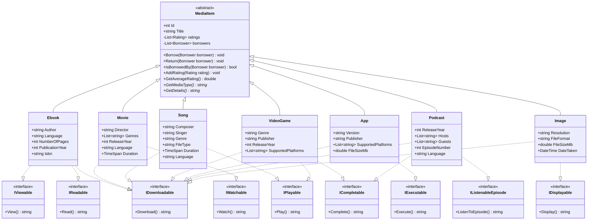
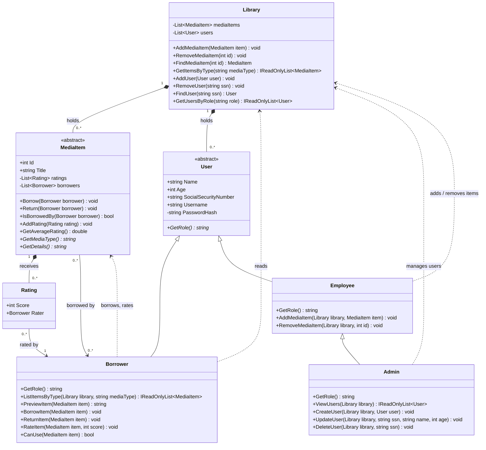
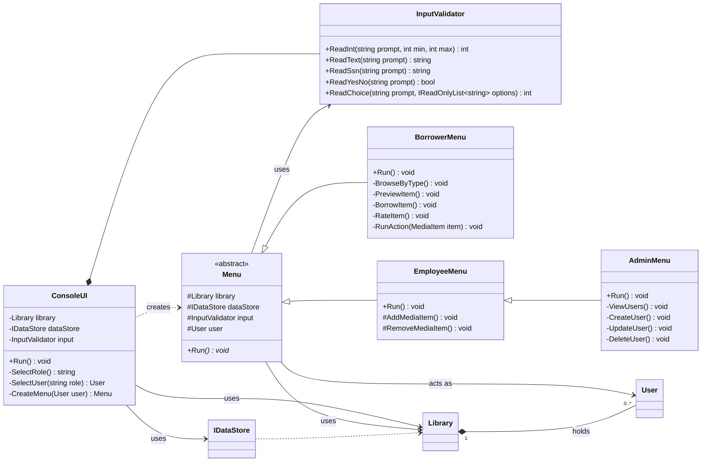
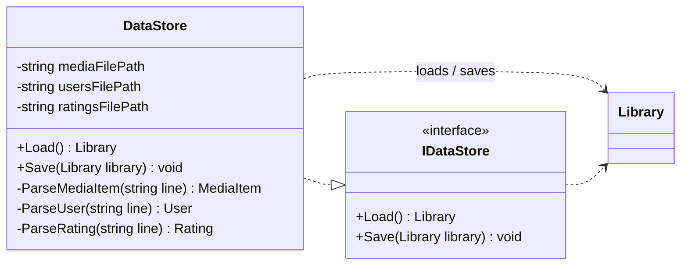

# Digital Media Library – UML Class Diagram

Sprint 2, step 4: class diagram for the Sønderborg library's console application (C#).
The diagram is written in [Mermaid](https://mermaid.js.org/syntax/classDiagram.html), so it renders
directly on GitHub (README, wiki, any `.md` file) and can be edited as plain text.
Copy the sections you need into `README.md`.

## Layers

| Layer | Classes | Responsibility |
| --- | --- | --- |
| Presentation | `ConsoleUI`, `Menu`, `BorrowerMenu`, `EmployeeMenu`, `AdminMenu`, `InputValidator` | Console interaction only: asks for the role, shows the menu for that role, validates every input, prints results and error messages. No business rules. |
| Domain | `Library`, `MediaItem` and its 7 subclasses, 9 capability interfaces, `Rating`, `User`, `Borrower`, `Employee`, `Admin`, `IDataStore` | All business rules: borrowing, rating only after borrowing, role permissions. No console output and no file access. |
| Persistence | `DataStore` | Reads and writes the data files (CSV) and implements `IDataStore`. |

Dependencies point inwards: Presentation uses Domain, Persistence implements an interface that the Domain defines.

## Complete class diagram

```mermaid
classDiagram
direction TB

namespace Presentation {
    class ConsoleUI {
        -Library library
        -IDataStore dataStore
        -InputValidator input
        +Run() void
        -SelectRole() string
        -SelectUser(string role) User
        -CreateMenu(User user) Menu
    }
    class InputValidator {
        +ReadInt(string prompt, int min, int max) int
        +ReadText(string prompt) string
        +ReadSsn(string prompt) string
        +ReadYesNo(string prompt) bool
        +ReadChoice(string prompt, IReadOnlyList~string~ options) int
    }
    class Menu {
        <<abstract>>
        #Library library
        #IDataStore dataStore
        #InputValidator input
        #User user
        +Run()* void
    }
    class BorrowerMenu {
        +Run() void
        -BrowseByType() void
        -PreviewItem() void
        -BorrowItem() void
        -RateItem() void
        -RunAction(MediaItem item) void
    }
    class EmployeeMenu {
        +Run() void
        #AddMediaItem() void
        #RemoveMediaItem() void
    }
    class AdminMenu {
        +Run() void
        -ViewUsers() void
        -CreateUser() void
        -UpdateUser() void
        -DeleteUser() void
    }
}

namespace Domain {
    class Library {
        -List~MediaItem~ mediaItems
        -List~User~ users
        +AddMediaItem(MediaItem item) void
        +RemoveMediaItem(int id) void
        +FindMediaItem(int id) MediaItem
        +GetItemsByType(string mediaType) IReadOnlyList~MediaItem~
        +AddUser(User user) void
        +RemoveUser(string ssn) void
        +FindUser(string ssn) User
        +GetUsersByRole(string role) IReadOnlyList~User~
    }

    class MediaItem {
        <<abstract>>
        +int Id
        +string Title
        -List~Rating~ ratings
        -List~Borrower~ borrowers
        +Borrow(Borrower borrower) void
        +Return(Borrower borrower) void
        +IsBorrowedBy(Borrower borrower) bool
        +AddRating(Rating rating) void
        +GetAverageRating() double
        +GetMediaType()* string
        +GetDetails()* string
    }
    class Ebook {
        +string Author
        +string Language
        +int NumberOfPages
        +int PublicationYear
        +string Isbn
    }
    class Movie {
        +string Director
        +List~string~ Genres
        +int ReleaseYear
        +string Language
        +TimeSpan Duration
    }
    class Song {
        +string Composer
        +string Singer
        +string Genre
        +string FileType
        +TimeSpan Duration
        +string Language
    }
    class VideoGame {
        +string Genre
        +string Publisher
        +int ReleaseYear
        +List~string~ SupportedPlatforms
    }
    class App {
        +string Version
        +string Publisher
        +List~string~ SupportedPlatforms
        +double FileSizeMb
    }
    class Podcast {
        +int ReleaseYear
        +List~string~ Hosts
        +List~string~ Guests
        +int EpisodeNumber
        +string Language
    }
    class Image {
        +string Resolution
        +string FileFormat
        +double FileSizeMb
        +DateTime DateTaken
    }

    class Rating {
        +int Score
        +Borrower Rater
    }

    class IViewable {
        <<interface>>
        +View() string
    }
    class IReadable {
        <<interface>>
        +Read() string
    }
    class IWatchable {
        <<interface>>
        +Watch() string
    }
    class IPlayable {
        <<interface>>
        +Play() string
    }
    class IListenableEpisode {
        <<interface>>
        +ListenToEpisode() string
    }
    class IDisplayable {
        <<interface>>
        +Display() string
    }
    class IExecutable {
        <<interface>>
        +Execute() string
    }
    class ICompletable {
        <<interface>>
        +Complete() string
    }
    class IDownloadable {
        <<interface>>
        +Download() string
    }

    class User {
        <<abstract>>
        +string Name
        +int Age
        +string SocialSecurityNumber
        +string Username
        -string PasswordHash
        +GetRole()* string
    }
    class Borrower {
        +GetRole() string
        +ListItemsByType(Library library, string mediaType) IReadOnlyList~MediaItem~
        +PreviewItem(MediaItem item) string
        +BorrowItem(MediaItem item) void
        +ReturnItem(MediaItem item) void
        +RateItem(MediaItem item, int score) void
        +CanUse(MediaItem item) bool
    }
    class Employee {
        +GetRole() string
        +AddMediaItem(Library library, MediaItem item) void
        +RemoveMediaItem(Library library, int id) void
    }
    class Admin {
        +GetRole() string
        +ViewUsers(Library library) IReadOnlyList~User~
        +CreateUser(Library library, User user) void
        +UpdateUser(Library library, string ssn, string name, int age) void
        +DeleteUser(Library library, string ssn) void
    }

    class IDataStore {
        <<interface>>
        +Load() Library
        +Save(Library library) void
    }
}

namespace Persistence {
    class DataStore {
        -string mediaFilePath
        -string usersFilePath
        -string ratingsFilePath
        +Load() Library
        +Save(Library library) void
        -ParseMediaItem(string line) MediaItem
        -ParseUser(string line) User
        -ParseRating(string line) Rating
    }
}

%% ---------- Presentation ----------
ConsoleUI *-- InputValidator
ConsoleUI ..> Menu : creates
ConsoleUI --> Library : uses
ConsoleUI --> IDataStore : uses
Menu <|-- BorrowerMenu
Menu <|-- EmployeeMenu
EmployeeMenu <|-- AdminMenu
Menu --> Library : uses
Menu --> User : acts as
Menu --> InputValidator : uses

%% ---------- Domain: collection ----------
Library "1" *-- "0..*" MediaItem : holds
Library "1" *-- "0..*" User : holds

%% ---------- Domain: media hierarchy ----------
MediaItem <|-- Ebook
MediaItem <|-- Movie
MediaItem <|-- Song
MediaItem <|-- VideoGame
MediaItem <|-- App
MediaItem <|-- Podcast
MediaItem <|-- Image
MediaItem "1" *-- "0..*" Rating : receives
MediaItem "0..*" --> "0..*" Borrower : borrowed by
Rating "0..*" --> "1" Borrower : rated by

%% ---------- Domain: capabilities ----------
Ebook ..|> IViewable
Ebook ..|> IReadable
Ebook ..|> IDownloadable
Movie ..|> IWatchable
Movie ..|> IDownloadable
Song ..|> IPlayable
Song ..|> IDownloadable
VideoGame ..|> IPlayable
VideoGame ..|> ICompletable
VideoGame ..|> IDownloadable
App ..|> IExecutable
App ..|> IDownloadable
Podcast ..|> IListenableEpisode
Podcast ..|> ICompletable
Podcast ..|> IDownloadable
Image ..|> IDisplayable
Image ..|> IDownloadable

%% ---------- Domain: users ----------
User <|-- Borrower
User <|-- Employee
Employee <|-- Admin
Borrower ..> Library : reads
Borrower ..> MediaItem : borrows, rates
Employee ..> Library : adds / removes items
Admin ..> Library : manages users

%% ---------- Persistence ----------
DataStore ..|> IDataStore
DataStore ..> Library : loads / saves
IDataStore ..> Library
```

## Focused views

The same classes and relationships, split so that the members are readable.

### Media types and capabilities (Domain)

`MediaItem` is abstract. Each media type implements the capability interfaces for its actions;
`IDownloadable` is shared by all seven.

### Users, library, borrowing and ratings (Domain)

`Admin` extends `Employee`. A `MediaItem` owns its `Rating`s and knows its borrowers, so it can refuse a
rating from someone who has not borrowed it.

### Presentation layer

`ConsoleUI` asks for the role and creates the matching menu. Every input goes through `InputValidator`.
`Library`, `User` and `IDataStore` are shown collapsed.

### Persistence layer

`DataStore` implements the `IDataStore` interface that the Domain defines.

## Requirements and where they appear in the diagram

| Requirement | Design element |
| --- | --- |
| Seven media types with their attributes | `Ebook`, `Movie`, `Song`, `VideoGame`, `App`, `Podcast`, `Image` (attributes as in the specification; id and title in `MediaItem`) |
| Actions per media type (view, download, read, watch, play, listen, complete, execute, display) | One capability interface per verb; each media class realizes the ones it supports |
| All items can be borrowed; only borrowers may rate | `MediaItem.Borrow`, `Return`, `IsBorrowedBy`; `AddRating` refuses a rating from a user who has not borrowed the item; `Borrower.RateItem` |
| Admin, Employee, Borrower with name, age, SSN | Abstract `User` with three subclasses |
| Ask for the role at startup | `ConsoleUI.SelectRole`, `SelectUser`, `CreateMenu` |
| Borrower lists, previews, rates, runs actions | `Borrower` and `BorrowerMenu` |
| Employee adds and removes items | `Employee` and `EmployeeMenu` |
| Admin has all Employee rights plus user management | `Admin` extends `Employee`; `AdminMenu` extends `EmployeeMenu` |
| Validate all inputs, clear errors | `InputValidator` in the UI; domain classes validate their own state and throw exceptions that the menus catch |
| Three-layer architecture | `Presentation`, `Domain` and `Persistence` namespaces |
| Persisted data (extension 3) | `IDataStore` and `DataStore` |

## Main design decisions

- **Capabilities are interfaces.** Each verb in the specification is an interface, not a deep inheritance chain.
  A menu offers the actions an item supports by testing which interfaces it implements.
- **`MediaItem` is abstract** because all items share state and logic (id, title, borrowers, ratings).
  Each subclass adds its own attributes and implements `GetDetails` for the preview.
- **`Admin` extends `Employee`** because the specification says an Admin has all of an Employee's rights.
- **The domain never prints.** Actions return a message string and `ConsoleUI` shows it, so the domain can be unit tested without a console.
- **`IDataStore` lives in the Domain, `DataStore` in Persistence.** Persistence depends on the Domain;
  replacing CSV with JSON changes only `DataStore`.
- **`Rating` is owned by `MediaItem`** and points to the `Borrower` who gave it.
  Assumption: one rating per borrower per item, score 1 to 5.

## Extending the design

- **New media type:** add a `MediaItem` subclass that implements the capability interfaces it needs, add it to the
  type list in `EmployeeMenu` and to the parser in `DataStore`. `Library`, `MediaItem`, `Borrower` and the other media types are not touched.
- **New capability** (for example `IShareable`): add one interface, implement it in the media types that support it,
  add one entry in `BorrowerMenu.RunAction`.
- **New user role:** add a `User` subclass and a `Menu` subclass, and one line in `ConsoleUI.CreateMenu`.

## Notation

| Symbol | Meaning |
| --- | --- |
| Solid line, hollow triangle | Inheritance (is a) |
| Dashed line, hollow triangle | Class realizes (implements) an interface |
| Solid line, filled diamond | Composition: the whole owns its parts |
| Solid line, open arrow | Association: holds a reference |
| Dashed line, open arrow | Dependency: uses as parameter or creates |
| `+` `-` `#` | Public, private, protected. Italic names are abstract. |

## Differences from the CRC cards to reflect in the next revision

- `ConsoleUI` is split into `ConsoleUI`, `InputValidator` and one `Menu` class per role, so a new role needs a new menu instead of editing one large class.
- `IDataStore` is placed in the Domain and used by `ConsoleUI` and `DataStore`. `Library` no longer lists it as a collaborator.
- `DataStore` also loads and stores media items and their borrowers (needed for extension 3), not only users and ratings.
- Ratings are held by `MediaItem`. `Library` holds media items and users only.
- Borrow and return are kept in `MediaItem` as the CRC says. There is no separate `Loan` class.
- `Borrower`, `Employee` and `Admin` receive the `Library` as a method parameter instead of storing it.
